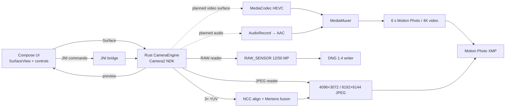
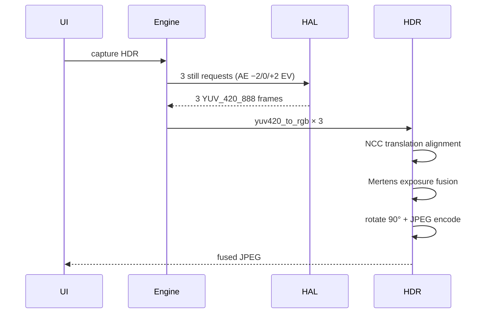
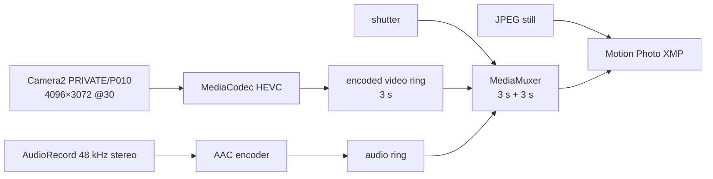
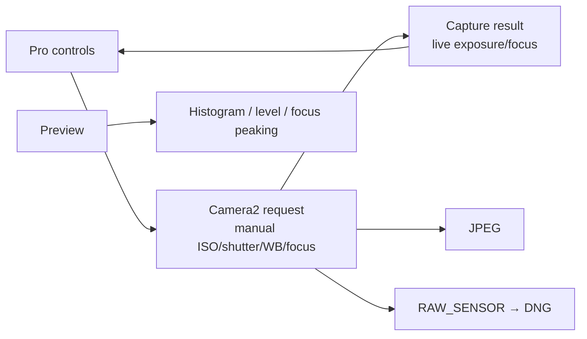
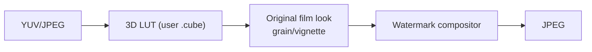

# Camera Pipeline

This document describes how a frame travels from the sensor to a file, and where
the next features will plug in.

## End-to-end overview

## 1. Camera session

One Camera2 NDK session owns:

- the preview `ANativeWindow` from `SurfaceView` (direct, zero-copy);
- one still output: JPEG, RAW or YUV depending on the mode.

Mode/lens changes restart the session on the same preview surface. This keeps the
stream configuration valid and avoids the HAL’s simultaneous-output limit. The
engine retries `setRepeatingRequest` instead of waiting for `onReady`, which this
HAL never invokes.

| Mode | Reader | Output |
|---|---|---|
| 12 MP JPEG | JPEG 4096×3072 | JPEG + EXIF orientation |
| 50 MP JPEG | JPEG 8192×6144 | HAL returns 1920×1440; rejected |
| RAW 12 | RAW_SENSOR 4096×3072 | DNG |
| RAW 50 | RAW_SENSOR 8192×6144 | DNG (requires `com.oneplus.camera`) |
| HDR 3× | YUV_420_888 4096×3072 | fused JPEG |

Fallback: if a mode cannot be configured, the bridge retries 12 MP JPEG and
reports the actual mode to the UI. If a JPEG’s SOF dimensions do not match the
requested size, the capture is rejected instead of writing a fake file.

## 2. Still pipeline

### JPEG

1. `TEMPLATE_STILL_CAPTURE` request → JPEG reader.
2. `onImageAvailable` copies the encoded buffer.
3. SOF dimensions are validated.
4. File is written; EXIF orientation 90 is set by the HAL.
5. UI shows the saved filename.

### RAW → DNG

1. `RAW_SENSOR` reader returns 16-bit Bayer data.
2. Row stride is respected; pixels are copied into a `u16` buffer.
3. `dng_writer` writes DNG 1.4 (RGGB, black 64, white 1023).
4. The public build uses a generic sRGB D65 ColorMatrix1; per-sensor calibration
   is a user-supplied file (see [DNG.md](DNG.md)).

### HDR 3×

Details: [HDR.md](HDR.md).

## 3. Live Photo pipeline (planned)

Target: **4096×3072 4:3 HEVC 30 fps**, **6.0 s** (3 s before + 3 s after),
AAC 48 kHz stereo 256 kbps, JPEG 4096×3072, Motion Photo XMP v1.

The ring stores **encoded samples**, not raw frames. A raw 6 s 4K 4:3 ring would be
several GB; an 80–120 Mbps HEVC ring is ~60–90 MB. Details:
[MOTION_PHOTO.md](MOTION_PHOTO.md).

## 4. Video pipeline (active)

- Camera2 video output surface → MediaCodec HEVC.
- AudioRecord 48 kHz stereo → AAC.
- MediaMuxer writes MP4.
- `4K 4:3` is verified on device: HEVC 4096×3072@30, ~79 Mbps, AAC stereo
  48 kHz/192 kbps, preview restored after stop.
- Modes:

| Mode | Stream | FPS | Notes |
|---|---|---|---|
| 4K 4:3 | 4096×3072 | 30 | native 4:3 |
| 4K 16:9 | 3840×2160 | 60 | UHD |
| 1080p | 1920×1080 | 60/120 | 120 high-speed |
| 720p | 1280×720 | 60/480 | 480 experimental |
| 10-bit | P010 | 30/60 | HEVC Main10; HDR10/HLG |

- EIS/OIS, bitrate presets, lock lens, lock WB, mic status, sound focus (research).
- 4K 120 and front 4K are not advertised by this HAL; not planned.
- Details: [VIDEO.md](VIDEO.md).

## 5. Pro/manual pipeline

Manual values are clamped to `SENSOR_INFO_SENSITIVITY_RANGE`,
`SENSOR_INFO_EXPOSURE_TIME_RANGE` and focus distance. Unsupported values fall back
with a visible message; the UI never shows a value the HAL ignored.

## 6. Portrait pipeline (planned)

1. Capture JPEG/YUV + depth (DEPTH16 or depth JPEG) if the HAL exposes it.
2. If no depth, run on-device segmentation.
3. Render synthetic bokeh with a depth-aware blur; preserve hair/edges.
4. Save the depth map alongside the JPEG for later refocusing (privacy: local only).

No vendor portrait algorithm or model is bundled.

## 7. Macro / focus-stack pipeline (planned)

1. Lock exposure/WB; scan focus from near to far.
2. Capture 3–9 frames at 4096×3072.
3. Align (translation/scale) and select sharpest regions per tile.
4. Blend focus stack; optional depth fusion.
5. Save JPEG (and optional DNG stack metadata).

## 8. Filters, LUT and watermark pipeline (planned)

- LUTs are user-supplied; the public build ships none.
- Filters are applied before encoding; no 1080p30 restriction.
- Watermarks use original templates and user text/images; no Hasselblad/GR/LUMO
  marks.

## 9. 10-bit and Ultra HDR pipeline (planned)

- **Video:** P010 → HEVC Main10 → MP4 with HDR10/HLG metadata.
- **Still HEIF:** YUV/P010 → HEVC 10-bit still → HEIF (`HeifWriter`), if supported.
- **Ultra HDR:** SDR JPEG + gainmap generated from a bracketed/linear image;
  Android-compatible gainmap, no vendor ProXDR.
- **Dolby Vision:** not portable; do not claim it.

## 10. Burst, motion and panorama (planned)

- **Burst/motion:** ring of frames → alignment → sharpest-frame/reference merge.
- **Panorama:** gyro/feature alignment → cylindrical warp → seam blend → 65:24 crop.
- **Night:** short bracket → align → merge → noise-aware tone map.
- **Long exposure:** manual shutter + dark-frame subtraction where useful.

## 11. Gallery/editor pipeline (planned)

- MediaStore scan; thumbnail cache; EXIF view.
- Non-destructive editor: crop/rotate/filter/watermark, export to JPEG.
- AI editing is optional research with open models; no vendor models.

## 12. Threading and ownership

| Thread | Work |
|---|---|
| UI thread | Compose only; never blocking JNI |
| `Dispatchers.IO` | `nativeCapturePhoto` (can block for HDR/RAW) |
| HAL callback thread | `onImageAvailable`: copy buffer, notify condvar |
| Rust session thread | JNI calls serialised by a process-global mutex |

The preview is written by the HAL directly into the `SurfaceView`; no CPU YUV→RGBA
pass and no per-frame JNI copies.

## 13. Data and files

- JPEG/RAW: `/sdcard/Android/data/com.oneplus.camera/files/Pictures/`.
- Live Photo/video (planned): same app-specific directory, then MediaStore.
- Naming: `IMG_<unix_ms>.<jpg|dng>`.
- No network permission, no upload.

## 14. Quality gates

A pipeline change is accepted only when:

1. `cargo test`, `cargo fmt --check`, Clippy and the Android build pass.
2. A device test proves the output dimensions/format and opens correctly.
3. HDR/DNG changes include a visual comparison and latency measurement.
4. No fake success: mismatched dimensions or missing audio are failures.
5. The relevant doc and `STATUS.md` are updated.

## 15. Evolution

| Horizon | Pipeline change |
|---|---|
| Now | DNG calibration hook, HDR tuning, 25 MP closed, 4K 4:3 video active |
| Next | 4K16:9 60, A/V tail trim, encoded ring, Motion Photo, Pro mode, zoom |
| Later | Portrait/macro, LUT/watermark, 10-bit/HDR, gallery/editor, burst/panorama |

See [ROADMAP.md](ROADMAP.md) and [BACKLOG.md](BACKLOG.md).
