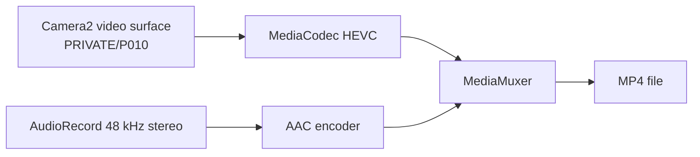

# Video

## Modes

| Mode | Size | FPS | Codec | Status |
|---|---|---|---|---|
| 4K 4:3 | 4096×3072 | 30 | HEVC Main | ✅ verified, ~79 Mbps |
| 4K 16:9 | 3840×2160 | 60 | HEVC Main | ✅ verified, ~82 Mbps |
| 1080p | 1920×1080 | 60/120 | HEVC | planned, 120 high-speed |
| 720p | 1280×720 | 60 | HEVC | planned |
| 720p slow | 1280×720 | 480 | HEVC | experimental, high-speed |
| 10-bit | P010 | 30/60 | HEVC Main10 | planned, HAL supports P010 |
| Front | 3280×2464 max | 30/60 | HEVC | front 1080p120; no native 4K |
| Audio | 48 kHz stereo | — | AAC-LC | ✅ 192 kbps HW; 256 kbps needs SW encoder |

The HAL advertises 4096×3072 @30, 3840×2160 @60, 1080p @120/240/480 and P010 on
the rear cameras. **4K 120 and native front 4K are not advertised**; the module’s
4K120 is reported to freeze on OnePlus 13 and front 4K is vendor upscale. Neither
is planned. **Dolby Vision** requires a Dolby licence/vendor encoder; we target
HDR10/HLG with HEVC Main10 instead.

## Device probes (2026-10-23)

`SelfTestActivity` tried 5K/6K/8K HEVC input surfaces through the normal Camera2
session:

| Probe | Result |
|---|---|
| 7680×4320 @30 logical | session rejected |
| 7680×4320 @60 logical | session rejected |
| 6016×4512 @30 main | session rejected |
| 6016×4512 @60 main | session rejected |
| Dolby codec query | `c2.qti.dv.encoder` exists |

The Camera2 stream list caps at 4096×3072, so these sizes need a vendor-specific
session/probe before they can be claimed. Dolby has an encoder component but a real
Dolby profile/pipe and licence-compatible path are unproven; keep HDR10/HLG as the
fallback. Do not advertise 8K/6K/Dolby until a real file exists.

## Architecture

- Kotlin creates the encoder surface and audio encoders.
- Rust adds the video surface to the Camera2 session and starts the repeating
  request with preview + video targets.
- MediaMuxer writes the MP4; the UI owns start/stop, pause and naming.
- Audio uses `AudioRecord` (stereo, 48 kHz); optional sound-focus research uses
  stereo/beamforming, not a vendor microphone API.
- The current `VideoRecorder` starts with 4096×3072@30 / 80 Mbps / AAC 192 kbps;
  the encoder reports show HEVC Main at ~79 Mbps and stereo AAC in the file.
- Known issue: audio tail can be 0.15?0.2 s longer than video. Start PTS is aligned;
  add audio-tail trimming before beta.

## Controls

- Bitrate presets: 40/60/80/120 Mbps (HEVC).
- Lock lens: disable logical-camera hand-off during recording.
- Lock white balance: freeze AWB after a short settle.
- Mic status: detect missing/occupied microphone and warn before recording.
- Stop sound: play immediately on stop; do not wait for mux finalisation.
- Auto frame rate: 24/30/60 based on light/scene (research).
- Filters: our pipeline is resolution-independent; no 1080p30-only restriction.
- EIS/OIS: use Camera2 stabilization modes; measure crop and FOV.

## Live Photo relationship

Live Photo uses the same video/audio encoders, but keeps **encoded samples** in a
ring buffer (3 s) instead of writing directly to a growing file. On shutter it
muxes 3 s before + 3 s after and appends the JPEG/XMP. See
[MOTION_PHOTO.md](MOTION_PHOTO.md).

## Stabilization

- Start with `CONTROL_VIDEO_STABILIZATION_MODE` (EIS) where supported.
- Record OIS/EIS behaviour at 4K 4:3 and 4K 16:9.
- Do not crop silently; document the field of view.

## Thermal and storage

- 4K 4:3 30 fps HEVC at 80–120 Mbps ≈ 36–54 GB/hour.
- Test 1/3/10 minutes; record battery temperature and dropped frames.
- Stop gracefully before thermal shutdown; keep the file playable.
- Long clips should be chunked into playable segments if the encoder/muxer fails.

## Acceptance

- 4K 4:3 30 fps: ✅ stable 30 fps, HEVC 4096×3072, stereo AAC, playable MP4;
  A/V start aligned, audio tail still needs trimming.
- 4K 16:9 60 fps: ? verified at 3840?2160, ~60 fps, ~82 Mbps.
- 1080p 120 / 720p 60: stable, audio in sync; slow-motion playback correct.
- 10-bit: correct profile/bit depth/metadata, or documented failure.
- Long recording: no corruption, no thermal shutdown, file size within budget.
- Filters/lock lens/lock WB/mic status work without breaking the recording.

## Backlog

See `VIDEO-101`…`VIDEO-206` in [BACKLOG.md](BACKLOG.md).
