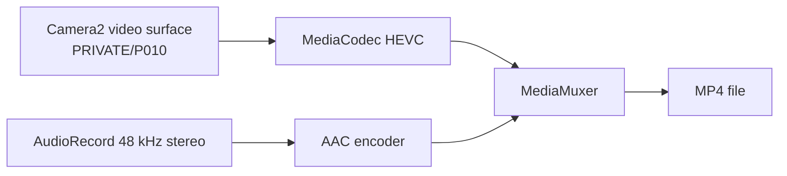

# Video

## Target modes

| Mode | Size | FPS | Codec | Notes |
|---|---|---|---|---|
| 4K 4:3 | 4096×3072 | 30 | HEVC | native 4:3 binned stream |
| 4K 16:9 | 3840×2160 | 60 | HEVC | standard UHD |
| 10-bit | P010 | 30/60 | HEVC Main10 | where the encoder accepts |
| Audio | 48 kHz | — | AAC-LC stereo 256 kbps | external mic safe |

The HAL advertises 4096×3072 @30 fps and 3840×2160 @60 fps for PRIVATE/P010 on the
rear cameras. 4:3 at 60 fps is not available.

## Architecture

- Kotlin creates the encoder surface and the audio encoders.
- Rust adds the video surface to the Camera2 session and starts the repeating
  request with both preview and video targets.
- MediaMuxer writes the MP4; the UI owns start/stop and file naming.

## Live Photo relationship

Live Photo uses the same video/audio encoders, but keeps **encoded samples** in a
ring buffer (3 s) instead of writing directly to a growing file. On shutter it
muxes 3 s before + 3 s after and appends the JPEG/XMP. See
[MOTION_PHOTO.md](MOTION_PHOTO.md).

## Stabilization

- Start with `CONTROL_VIDEO_STABILIZATION_MODE` (EIS) where supported.
- Record OIS/EIS behavior at 4K 4:3 and 4K 16:9.
- Do not crop silently; document the field of view.

## Thermal and storage

- 4K 4:3 30 fps HEVC at 80–120 Mbps ≈ 36–54 GB/hour.
- Test 1/3/10 minutes; record battery temperature and dropped frames.
- Stop gracefully before thermal shutdown; keep the file playable.

## Acceptance

- 4K 4:3 30 fps: stable 30 fps, audio in sync, playable MP4.
- 4K 16:9 60 fps: stable 60 fps, audio in sync.
- 10-bit: correct profile/metadata if the encoder accepts; otherwise documented.
- Long recording: no corruption, no thermal shutdown, file size within budget.

## Backlog

See `VIDEO-101`…`VIDEO-202` in [BACKLOG.md](BACKLOG.md).
