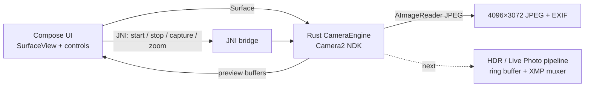

# OpOpenCam

**A rootless, professional camera for the OnePlus 13 — Rust engine, native UI, no watercolor.**

[](https://github.com/RandoTeam/OpOpenCam-Camera/actions/workflows/rust-camera-ci.yml)
[](scripts/check.ps1)
[](CHANGELOG.md)
[](https://www.android.com/)
[](../LICENSE)

> **CI:** GitHub Actions runs formatting, host tests, Clippy and the Android build
> on every push/PR. See [docs/CI.md](../docs/CI.md).

OpOpenCam is a hybrid camera stack for the OnePlus 13 (`PJZ110`, Snapdragon 8 Elite,
ColorOS 16 / Android 16). The camera session and image processing live in **Rust**;
the interface is **Jetpack Compose**.

The goal is not another GCam port. The goal is a camera we control end to end:
direct Camera2 NDK access, a detail-preserving multi-frame pipeline, 4:3 4K recording,
and a Live Photo implementation with real stereo sound and a full 3 s + 3 s window.
The full stock/OPCameraPro feature map is in
[../docs/FEATURE_PARITY.md](../docs/FEATURE_PARITY.md).

---

## Why

Modern phone photos often lose texture to aggressive neural denoising and
over-sharpening. GCam ports produce pleasant stills but are closed, slow in burst,
and cannot switch lenses smoothly; LMC 8.3/8.4 Motion Photos analysed on this device
either have **no audio track** or use dual low-resolution H.264 tracks.

OpOpenCam takes the opposite route:

- no OPlus APS/neural “watercolor” pipeline;
- explicit exposure bracketing and fusion for deep shadows and unclipped highlights;
- 10-bit P010 and RAW where the HAL supports it;
- 4:3 video at 4096×3072 (30 fps) or 3840×2160 (60 fps);
- Motion Photo with 48 kHz stereo audio and a 6 s window.

## Current status

| Area | Status |
|---|---|
| Rust Camera2 NDK preview → `SurfaceView` | ✅ verified on device |
| Real JPEG capture (4096×3072, EXIF orientation) | ✅ verified on device |
| Compose shell (preview, shutter, lens chips, zoom) | ✅ working |
| Host unit tests for media/math modules | ✅ 29 passing |
| 50 MP JPEG | ❌ HAL returns 1920×1440; use RAW 50 |
| 50 MP RAW → DNG | ✅ verified: 8192×6144, 96 MB, DNG 1.4 |
| Physical lens switching / mode restart | ✅ verified: cameras 3 / 0 / 4 |
| Exposure bracketing + HDR fusion | ✅ verified: 3 YUV frames + NCC + Mertens |
| Preview restart latency | ✅ ~50 ms after the onReady fix |
| Live Photo (6 s, 4:3, stereo) | 🚧 planned |
| 4K video / audio recording | 🚧 planned |
| Polished UI and animations | 🚧 in progress |

The first real capture is a 2.8 MB JPEG at 4096×3072 produced by the Rust engine and
saved through the Compose shell. This is an alpha; see [CHANGELOG.md](CHANGELOG.md)
for known limitations.

### Capture modes (0.3.0-alpha.1)

| Mode | Output | Notes |
|---|---|---|
| 12 MP | 4096×3072 JPEG | verified on device |
| 50 MP JPEG | 8192×6144 expected | **unavailable**: HAL returns 1920×1440 |
| RAW 12 | 4096×3072 DNG | verified: 25 MB |
| RAW 50 | 8192×6144 DNG | verified: 96 MB, requires `com.oneplus.camera` |
| HDR 3× | 4096×3072 JPEG | verified on logical / ultra-wide / tele |

Mode/lens changes restart the Camera2 session on the same surface. The engine
reports the actual mode after a HAL fallback and validates the real JPEG SOF size.
Details: [docs/CAPTURE_MODES.md](../docs/CAPTURE_MODES.md).

### Device verification — 2026-10-22

- Preview and 12 MP JPEG: 4096×3072, ~1.3 MB.
- RAW 12: DNG 4096×3072, ~25 MB.
- RAW 50: DNG 8192×6144, 96 MB, 16-bit, DNG 1.4.
- HDR 3×: three YUV frames → fused JPEG 3072×4096 on logical, ultra-wide and tele.
- Lens switching: camera 3 (ultra-wide), 0 (logical), 4 (tele) open and capture.
- 50 MP JPEG: rejected by the new SOF check (HAL returns 1920×1440).
- The app package is `com.oneplus.camera`; the old patched clone with the same
  package must be uninstalled before installing OpOpenCam.

## Architecture



- **Rust** owns `ACameraManager`, the capture session, the direct preview output and
  the JPEG `AImageReader`.
- **Compose** owns layout, gestures, animations and permissions.
- **JNI** is intentionally small: start/stop, capture, zoom, status.

More detail: [docs/ARCHITECTURE.md](../docs/ARCHITECTURE.md).

## Verified hardware baseline

From the device's Camera2 static metadata (`dumpsys media.camera`, 2026-10-22):

| Camera | Role | Active array | RAW | Zoom |
|---|---|---|---|---|
| 0 | logical SAT | 4096×3072 | 8192×6144 advertised | 0.6–20× |
| 1 | front | 3280×2464 | 6560×4928 | 1–10× |
| 2 | main (LYT-808) | 4096×3072 | 8192×6144 advertised | 1–10× |
| 3 | ultra-wide (JN5) | 4096×3072 | 8192×6144 advertised | 1–10× |
| 4 | 3× tele (LYT-600) | 4096×3072 | 8192×6144 advertised | 1–10× |

Rear cameras advertise `RAW`, `YUV_REPROCESSING`, `PRIVATE_REPROCESSING`,
`BURST_CAPTURE`, `DYNAMIC_RANGE_TEN_BIT`, `LOGICAL_MULTI_CAMERA`.
4096×3072 output is available at **30 fps** in YUV/PRIVATE/P010; 3840×2160 at
**60 fps**. Full baseline and Motion Photo measurements live in
[DEVICE_TEST_PLAN.md](../docs/DEVICE_TEST_PLAN.md).

> **Package identity:** the APK installs as `com.oneplus.camera` (the Chi HAL
> whitelist name). If the old patched stock clone is installed, remove it first:
> `adb uninstall com.oneplus.camera`. The stock camera `com.oplus.camera` is not
> affected.

## Build

Requirements:

- Rust 1.98+ with `aarch64-linux-android`;
- Android SDK 36, NDK 28.2;
- JDK 21;
- Gradle 8.13 (wrapper included).

```powershell
# from the repository root
.\rust_camera\scripts\build.ps1
```

Linux/macOS:

```bash
./rust_camera/scripts/build.sh
```

The script builds the Rust `.so`, copies it into `jniLibs`, and assembles the
debug APK. Install with:

```powershell
.\rust_camera\scripts\install.ps1
```

Manual commands are documented in [docs/ARCHITECTURE.md](../docs/ARCHITECTURE.md).

## Project layout

```
rust_camera/
├── rust_core/                 # Rust Camera2 NDK engine
│   └── src/
│       ├── bridge.rs          # JNI surface
│       ├── camera_engine.rs   # session, preview, JPEG capture
│       ├── capture_modes.rs   # 12/50 MP, RAW, HDR modes
│       ├── hdr.rs             # NCC alignment + exposure fusion
│       ├── sensors.rs         # OnePlus 13 topology + vendor tags
│       ├── motion_photo_xmp.rs
│       ├── dng_writer.rs
│       └── circular_ring_buffer.rs
├── android_app/               # Jetpack Compose shell
├── scripts/                   # build / check / install
├── CHANGELOG.md
└── VERSION
```

Project-level docs (vision, pipeline, roadmap, testing, ADRs) live in
[`../docs/`](../docs/README.md). The public build does **not** include
vendor-specific LUT/tone modules, device calibration assets or extracted vendor
binaries. Those remain in the private research archive.

## Quality principles

1. **Texture over plastic.** Chroma denoise may be strong; luma detail is preserved.
2. **Highlight roll-off, not clipping.** Soft-knee tone mapping and exposure fusion.
3. **No hallucinated detail.** No neural upscaling or AI sky replacement.
4. **Measured, not guessed.** Every HDR/video claim is compared against LMC and stock.
5. **10-bit where possible.** P010 and HEIF/AV1 are first-class targets.

Full quality contract: [docs/QUALITY.md](../docs/QUALITY.md).

## Roadmap

- **M1 (done):** real preview + real JPEG from Rust.
- **M2:** 50 MP JPEG, RAW/DNG, 50 MP vendor tag.
- **M3:** physical lens switching and smooth zoom.
- **M4:** exposure bracketing + alignment + HDR fusion.
- **M5:** Live Photo 6 s (3 s before + 3 s after), 4:3, stereo AAC.
- **M6:** 4K 4:3 30 fps / 4K 16:9 60 fps video, UI polish, beta release.

Detailed milestones and acceptance criteria: [docs/ROADMAP.md](../docs/ROADMAP.md).

## Data and privacy

Device captures (HAL dumps, reference Motion Photos, sample images) are kept locally
under `test_reports/device_capture_*` and are **not** committed. The repository only
contains derived, non-identifying analysis and the test plan.

## Contributing

See [CONTRIBUTING.md](../CONTRIBUTING.md). Use Conventional Commits, keep PRs focused,
and never commit personal photos or device dumps.

## License

MIT for the original code. Third-party names, extracted color profiles and
trademarks remain the property of their owners; see [LICENSE](../LICENSE).
